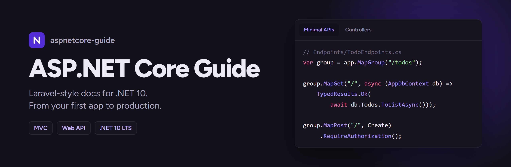
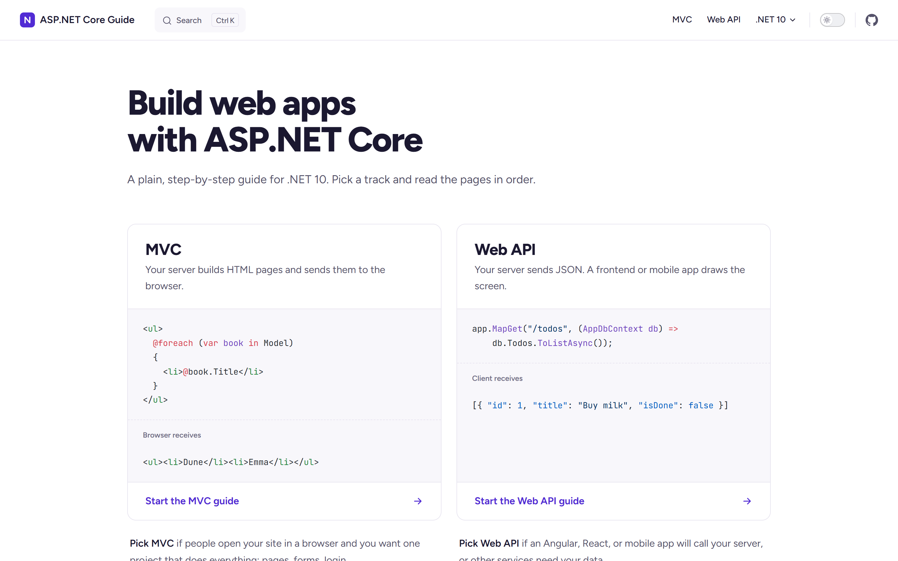
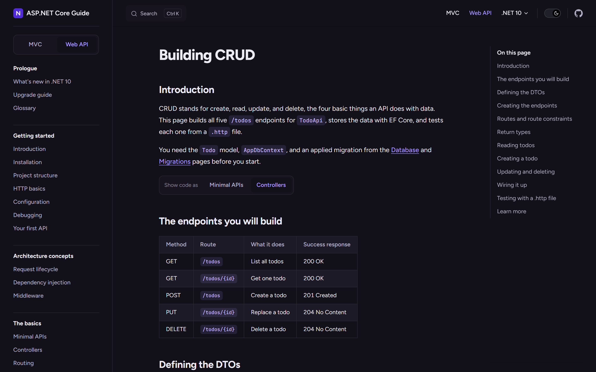

<p align="center">
  
</p>

<p align="center">
  <a href="https://salehabuhussein.github.io/aspnetcore-guide/"><strong>Read the guide</strong></a>
  ·
  <a href="https://salehabuhussein.github.io/aspnetcore-guide/mvc/introduction">MVC track</a>
  ·
  <a href="https://salehabuhussein.github.io/aspnetcore-guide/web-api/introduction">Web API track</a>
  ·
  <a href="samples">Sample apps</a>
</p>

<p align="center">
  <a href="https://github.com/SalehAbuhussein/aspnetcore-guide/actions/workflows/deploy.yml"></a>
  <a href="https://github.com/SalehAbuhussein/aspnetcore-guide/actions/workflows/ci.yml"></a>
  
  <a href="LICENSE"></a>
</p>

A plain, step-by-step guide to ASP.NET Core on .NET 10, laid out like the [Laravel docs](https://laravel.com/docs). Pick a track and read the pages in order: you start from an empty folder and end with a tested, deployed app.

> Unofficial. Not affiliated with Microsoft.

## Two tracks

| | MVC | Web API |
|---|---|---|
| You build | `BookShelf`, server-rendered pages with Razor | `TodoApi`, a JSON API |
| Code style | Controllers and views | Minimal APIs **or** controllers, switchable on every page |
| Frontend | Razor, view components, htmx | Calling the API from Angular |

Each track has the same shape:

- **Part 1: Build your app.** HTTP basics, architecture concepts, routing, data with EF Core, auth, file uploads, email, background tasks, testing, and deployment.
- **How-to guides.** Short recipes: welcome email, login, password reset, admin role, CSV export, nightly jobs, PostgreSQL, Azure, Docker.
- **Part 2: Advanced.** Caching, queues, SignalR, transactions, observability, CI/CD, and testing with real databases.
- **Help.** CLI cheat sheet, troubleshooting, glossary.

## Screenshots

<p align="center">
  
  
</p>

## Code you can trust

Every code sample was compiled against the .NET 10 SDK, and most were run against a live app. The finished app for each track lives in [`samples/`](samples). It was built by following the pages in order, and CI builds and tests it on every push.

## Run the docs locally

You need [Node.js](https://nodejs.org) 18 or newer.

```bash
npm install
npm run docs:dev
```

Open the address it prints, usually http://localhost:5173.

| Command | What it does |
|---|---|
| `npm run docs:dev` | Dev server with live reload |
| `npm run docs:build` | Static site in `docs/.vitepress/dist` |
| `npm run docs:preview` | Serve the built site |

## Run the sample apps

You need the [.NET 10 SDK](https://dotnet.microsoft.com/download).

```bash
dotnet run --project samples/BookShelf
dotnet run --project samples/TodoApi
```

See [samples/README.md](samples/README.md) for tokens, secrets, and tests.

## Contributing

Fixes and new pages are welcome. Read [CONTRIBUTING.md](CONTRIBUTING.md) for the page format, writing rules, and how the Minimal APIs / Controllers switch works. Every page has an "Edit this page on GitHub" link.

## License

[MIT](LICENSE) © Saleh Abuhussein
